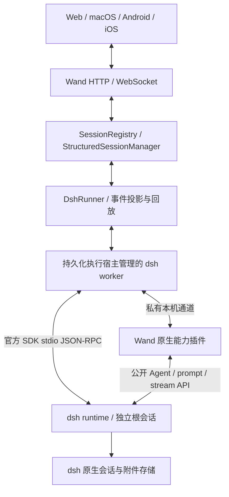

# Wand 原生集成 DeepSeek Harness（dsh）调研

调研日期：2026-11-01。结论级别：源码与发布包核查，完成官方传输库的无模型实验；尚未启动完整 dsh runtime，也未做 Wand 联调。

## 结论与建议

**可行，建议作为独立执行工具原生接入。推荐路径是：Wand 的 structured 会话链路 + 官方 dsh SDK JSON-RPC + 一个基于 dsh 公开扩展接口的小型 Wand 插件。**

这里的“原生支持”指用户在 Wand 新建会话、员工候选和任务执行器中直接选择 DeepSeek Harness，继续使用 Wand 的消息、工具卡、附件、审批、问答、排队、停止和恢复；实际 agent loop、工具执行、模型路由和原生会话由 dsh 负责。Web、macOS、Android、iOS 使用同一套服务端语义。移动端控制服务器上的 runtime，不需要在手机中运行 Node。

仅接官方 SDK 能获得结构化基础能力，但仍缺逐字输出、单会话取消、运行中插话等面向人的控制接口。dsh 底层已有对应公开 API，因此缺口主要在桥接层；无需重写 agent loop。完整生产可行性仍取决于停止、断线恢复、事件合并、权限边界及资源占用的实测。

建议先用 **`0.2.2-alpha.2` 的同版本 SDK/runtime** 做协议原型，锁定全部依赖；它已有发布包中的审批与问答接口。原生命令接入须单独验版本，不能把主分支文档当作这个发布包的能力。如果生产阶段不接受 alpha，可等待这些能力进入经验证的后续版本，保留相同适配结构。

## 对象、版本与核验范围

调研对象是官方 [deepseek-ai/deepseek-harness](https://github.com/deepseek-ai/deepseek-harness)，npm 主包 `@deepseek-ai/dsh`。不包括社区 `dsh-code`、`dcli`，也不是通过另一执行器调用 DeepSeek 模型 API。

| 基线 | 精确身份 | 本轮用途 |
| --- | --- | --- |
| npm `latest` / `next` | `0.2.1-rc.5`；tag commit `b830ec950faba0a46dda564be3e2d854afed94f1` | 当前默认安装版本 |
| npm `alpha` | `0.2.2-alpha.2`；tag commit `f3803c96974ad4a94195fb97e5c637e9c2a3afe3` | 建议的原型基线 |
| 调研时主分支 | `ce7073d51254c26cd63b22a60835b8f948deb447` | 观察尚未随上述包发布的能力 |
| Wand | HEAD `f89ea2760a557cb8a3ddb6424ba11f7d79cc227f` 加本机已有工作区改动 | 实际对照源码；并非干净发布版本 |

核查 npm registry 元数据，并下载检查四个公开 tarball：rc.5 与 alpha.2 的 `dsh-sdk-protocol`，alpha.2 的 `dsh-sdk-client`、`dsh-sdk-jsonrpc-server`。均验证了 registry 声明的 SHA-512 integrity。没有执行安装脚本。

重要区别：主分支的 package version 字符串也为 `0.2.2-alpha.2`，但其源码比同名已发布包多出接口。只看 package version 或 README 无法得出同等能力结论。

Wand `.nvmrc` 为 Node `24.21.0`，满足 alpha.2 的 Node `>=24.9.0` 要求。dsh 主项目是 MIT 许可，分发仍需保留许可及第三方声明。官方明确标为 developer preview，并声明会有兼容性破坏。

## 能力核对

下表中 SDK 指官方 stdio SDK；“插件可补”是设计判断，尚未联调。

| 能力 | SDK rc.5 | SDK alpha.2 发布包 | 主分支 / 原生扩展依据 | 对 Wand 的影响 |
| --- | --- | --- | --- | --- |
| 文本、多轮、原生会话 ID | 有 | 有 | `session/prompt` | 能直接适配 structured 会话 |
| 持久化恢复 | 有 | 有 | `session/resume`，恢复不自动重发输入 | 保留原 ID、存储根、工作目录；不制造替代会话 |
| 已提交文本、思考、工具调用/结果、用量 | 有 | 有 | `session.event` / `SessionEvent` | 可映射现有消息与工具卡 |
| 实时逐字输出 | 未转发原生 chunk | 未转发原生 chunk | `agent/assistant-stream` 是公开的进程内事件；主分支 SDK 仍只转发 session 事件等 | 插件转发 transient 流，最后以 durable 事件收敛 |
| 权限审批回传 | 无 SDK 请求通道 | `approval/request` | 一次允许、拒绝、取消 | 必须真正回传决定，不能把默认权限改成全允许 |
| 用户问答 | 无 SDK 请求通道 | `user-question/ask` | 主分支另有 `{ cancelled: true }` 的用户关闭语义 | alpha.2 不能冒用新增的关闭回答格式 |
| 用户问答的子代理覆盖 | 无 | SDK 桥按其持有的根 Agent 判断 | 主分支同样按根 Agent 精确身份路由；审批桥则覆盖归属内子代理 | 子代理问题需明确桥接与验收，不能据根会话成功推断全覆盖 |
| 单会话取消、关闭 | 无 | 无 | 主分支 SDK 仍无；公开 `agent.cancel()`、`AgentHandle.dispose()` 存在 | 正式原生体验由插件提供精确取消；整进程退出只作有说明的兜底 |
| 排队 / 插话 | `prompt` 入下一轮队列 | 同左 | `followup()`、`steer()`、inbox API | 下一轮与下一步不同，必须区分 |
| 图片输入 | 有，要求精确模型支持 | 同左 | raster image → 原生附件存储 | 转换上传的图片；不能只发送路径冒充看图 |
| 模型与思考档位 | 初始化时选择 | 同左 | `agent.model.current/select`；ACP 可动态设置 | SDK 无模型目录/动态切换 RPC，插件提供真实目录和选择状态 |
| 员工 system prompt | 没有 prompt 参数 | 同左 | `ctx.systemPrompt.section()` / Agent scope | 插件按会话安装系统段；不拼接进用户消息 |
| Skills / MCP | 由 profile 组合 | 同左 | filesystem skills；MCP stdio / Streamable HTTP | 会话选择转成受控组合，不能声称直接兼容 Pi 扩展 |
| `/compact`、`/permission`、`/plan`、`/goal` | 无命令路由 | 无命令路由 | 主分支新增 `session/query` | 按真实版本开放；alpha.2 下斜杠文本可能只会被当作普通提示词 |
| 导入已有 dsh 历史 | 有恢复，无 SDK list / transcript replay | 同左 | ACP 有 list；持久化服务有读取接口 | 首版恢复 Wand 创建的会话；外部历史导入单独做只读适配 |
| Web 富卡、浏览器 UI、全部插件界面 | 不包含 | 不包含 | 需宿主投影 | 不承诺与 dsh Desktop 全量 UI 等价 |

事件“流式送达”和“逐字生成”需要分开理解。SDK 监听 `session/event`；`assistant/message` 在一次模型尝试结算后提交，里面包含 compact stream。真正即时的 `agent/assistant-stream` 没有被 SDK 转发。把结算后的文本再播放成打字动画不属于原生实时输出。

### 为什么不单独采用 ACP

rc.5 的 ACP 已有创建、列出、恢复、取消、关闭、动态模型/思考档、MCP 和审批，控制面比同期 SDK 完整。它适合统一自动化执行器。

但该实现明确将 ACP 定位为 automation-only：只传标准语义更新，不传原始 deltas、DSH 展示数据、原生命令、计划、问答 elicitation 等。如果以它作为唯一接口，仍需另补用户交互与实时输出，而且与 SDK 能力会重叠。它是受限自动化的可选路线，不是本次完整原生体验的首选。这里的限制来自 dsh 当前 ACP 实现，不代表 ACP 标准整体永远不支持这些能力。

### 路线比较

| 路线 | 能得到什么 | 代价与结论 |
| --- | --- | --- |
| PTY / headless 输出包装 | 终端或一次性最终文本 | 不满足本轮原生支持目标 |
| 嵌入 dsh Web | 保留对方现成界面 | 难统一 Wand 会话、身份与四端交互；不建议作为主入口 |
| 只接 ACP | 标准自动化、取消、恢复、审批 | 有明确交互缺口，可作为未来独立自动化能力 |
| 只接 SDK | dsh 结构化事件、附件与较完整原生记录 | 是基础，但不足以独立完成原生体验 |
| **SDK + 公开 API 插件** | 原生 agent loop，加完整宿主控制和事件投影 | **推荐；保持小型桥接，不复制核心逻辑** |
| 将 Cordis / dsh agent loop 嵌入 Wand Server | 直接访问所有服务 | 生命周期、依赖和插件故障耦合较大；本轮无必要 |

## 推荐结构

1. **执行身份。** 新增 `provider: "dsh"`、建议 runner 名 `dsh-sdk-jsonrpc`，使用现有外部执行语义 `engine: "cli"`。展示名用“DeepSeek Harness”。官方库虽叫 SDK，其运行方式仍是独立子进程，不应套入 Wand 当前仅为 Pi 定义的 `core` / “Wand Agent”。
2. **持久化 worker。** 参考现有 `codex-app-worker.ts` 的宿主模式，由 `StructuredExecHost` / tmux 托管 worker。worker 持有 dsh 的双向 stdio、请求映射、控制通道和待回答问题；Server 断开观察不关闭 dsh。现有 pump 的 `stdinData` 是一次写入即关闭，不能直接用来承载长期 SDK RPC。
3. **隔离根会话。** 首版每个活跃 Wand 会话有一个独立 dsh runtime 根，允许其拥有自己的受管子代理。避免多个无关根共用一个进程后“停止 A 导致 B 中断”。空闲回收只能在根、后代、审批和输入交接全部结束后进行。启动时间与 RSS 需要测量后再定回收策略。
4. **官方 SDK。** 复用 `HarnessClient` 的初始化、prompt、恢复、等待和问答/审批请求机制；更适合以低层订阅消费，避免 `run()` 累积全部 notifications。固定 SDK/runtime 同版本。`dshBin` 是 Node 可执行模块文件路径，不是任意 shell 包装脚本。
5. **小型插件。** 插件仅负责 SDK 尚未暴露的原生控制与展示：实时流、精确 cancel/steer、模型目录/选择、会话系统段、必要的子代理问答和待交互状态。使用公开 `ctx.agents`、`agent.ctx`、`agent.model`、`agent/assistant-stream` 等接口。不要访问 SDK 私有 sessions Map，也不要覆盖 SDK 内部 request handler。
6. **独立扩展通道。** 在 dsh profile 中挂载插件，通过私有 Unix socket 等本机双向通道与 worker 连接；现有官方 stdio 保持原协议。目录/通道按 session + execution incarnation 绑定，权限限制在本机用户，显式协商桥接版本与能力。所有通知同时携带根/子会话身份，服务端拒绝失效或跨会话命令。
7. **原生持久化归属。** dsh 保存模型历史、inbox、附件与原生状态；Wand 保存自己的会话、投影、任务归属和输入交接事实。原生 ID 可沿用现有通用 resume 字段 `claudeSessionId`，无需为本轮重命名历史 schema。额外 profile/runtime version/checkpoint 用新增字段保留，不破坏旧会话。

Wand 原有结构已支持这条路线，但不是增加一个下拉选项就完成。尤其要补 `structured-session-manager-replay.ts` 的恢复 reducer，否则实时可看、重启后不可恢复。

## 必须做对的行为

### 输入、停止与恢复

- Wand request/message ID 与 dsh message ID 单独记录。`session/prompt` 返回的是入队身份，不是模型完成结果。先订阅再发送，同时处理“通知先于响应”。失去回执时保留未知状态，不自动重发。
- 官方 SDK 生成 dsh message ID，不接受 Wand 的幂等键。worker 应保存交接记录；对“dsh 已收、worker 尚未记下就崩溃”的窗口不能声称 exactly-once。无法证实未接受时，需要原会话核对，不能通过文本或时间窗猜测。
- `session.status: idle` 不等于该用户输入或全部子任务完成；按 message receipt、turn ending、`session/wait` 与后代状态共同结算。默认 SDK 对 max-tokens 的 success 映射不能直接当作 Wand 任务完成，使用原始 stop reason。
- 插件取消应作用于精确 live Agent，处理受管后代、待审批及待问答，并等待活动收敛。普通“停止当前执行”不能顺手丢掉 Wand 中尚未交接的排队消息；dsh `cancel()` 默认会清 inbox，`keepInbox` 必须按双方队列所有权明确设置。
- 原型可验证“一会话一进程 → shutdown → 原 ID resume”的兜底，但正式交付要有原生取消。停止失败不能只改变 UI；停止是否完成要有运行时回执。
- Server 重启后重新订阅现存 worker，恢复输出水位与待交互状态。dsh runtime 真正退出后才走原生 resume；恢复历史不会重新发送旧事件，因此 Wand 自己需要完整投影/checkpoint。
- dsh resume 能恢复对话，不承诺复活旧 bash/browser 进程。runtime 重启后的待审批/问题句柄失效，不得接受旧按钮的迟到回复。

### 事件投影

- `assistant/message` → text / thinking；`tool/call` → `tool_use`；`tool/result` → `tool_result`；usage 保留“未知”而不是补零费用。
- 同一模型步骤的实时流、最后的 `assistant/message` 和工具生命周期不能重复立卡。以 session、attempt、turn/step、call ID、seq 建立关联，结算事件替换临时展示。
- durable `surfaceOp.replace` 与压缩是历史投影变更，不能简单 append 所有文本。未知事件允许保留私有原始记录，不能导致解析器把一轮误报完成。
- 子代理继承使用原生 lineage 与运行所有权，不能按工具名或文本猜测。外部子代理与 in-process 子代理的通知支持也需要分开。
- stdout/日志与 WebSocket 输出做有界缓冲和增量 checkpoint。原始系统提示、配置、凭据不广播给客户端；图片使用受控附件访问，不塞满每次快照。

### 权限、员工与资源选择

- `approval/request` 只有 toolName、可选 callId/reason，完整参数需关联已记录的工具调用。不能因缺少参数就“默认允许”。拒绝、取消、断线、迟到回答均不得授权。
- 问答复用现有 `question_request` 语义与原生 UI，保留选项 ID、多题、自由输入及有效期。根 Agent 与子代理各自验证。alpha.2 的问答 API 没有主分支新增的用户 dismissal 返回格式，需桥接或暂时明确限制。
- 员工身份、项目规则走会话作用域 `systemPrompt.section`；建议 `interpolate: false` 保留用户原文，避免规则中的模板样式文本被解释。更新/恢复后重新应用，不能污染其他根会话。
- Skills、MCP、工具权限按用户选择生成 profile/Agent scoped 组合。dsh 的 MCP 支持 tools/resources，但不支持 MCP prompt templates；也不能据此承诺支持 MCP Apps 的界面。
- 模型目录优先由 runtime 公共服务读取实际路由能力，启动才挂载用户选定的插件。没有安装 dsh 时显示不可用；不自动切 Pi、换模型或追加付费候选。

### 组合与运行环境

- 使用隔离的 Wand dsh home/profile，显式选择版本和插件。建议 runtime 包按版本安装于独立目录，按需加载，不把整个 dsh 依赖树放到 Wand Server 启动路径。
- 子进程环境通过 Wand 的 `buildChildEnv()` 底座及现有凭据策略构造。复用用户已授权的凭据来源，但不将 key 回写公共配置、提示词、日志或源码。
- dsh patch 覆盖的是整块 config，并非深度 merge；生成组合时必须保留需要的原配置。profile 修改通常需重启，不能宣称即时生效。
- 默认 profile 包含原生 schedules/goals 等自主行为。首版应明确 Wand 调度与 dsh 自主执行的所有权，避免同一个任务被两套调度重复触发。未完成桥接的能力不显示为可用。
- 核实到 dsh 默认包含额外的 canonical session-log 上报：`session-log-deepseek.enabled` 默认 true；OTel 是单独的反馈触发上报。Wand 专用组合建议关闭这两个附加通道，只保留用户选择的模型调用；这不会禁用本地会话持久化。

## Wand 修改范围

以下为实际入口，新增文件名是建议，尚未创建实现。

| 范围 | 已有入口 | 拟变更 |
| --- | --- | --- |
| Provider、runner、DTO | `src/provider-catalog.ts`、`src/types.ts`、`src/session-provider.ts`、`src/structured-provider-common.ts` | 增加 dsh 身份、runner、能力与严格校验，保留旧 schema |
| 模型、配置、版本发现 | `src/models.ts`、`src/models/shared.ts`、`src/models/thinking.ts`、`src/config.ts`、`src/provider-cli-updater.ts` | dsh 模型目录、思考档、默认值、安装状态及固定兼容版本 |
| 执行与恢复 | `src/structured-session-manager.ts`、`src/structured-session-manager-replay.ts`、`src/structured-exec-host.ts`、`src/structured-tmux-host.ts` | 接入 runner、执行归属、双向控制、停止和回放 |
| 实现参考 | `src/structured-codex-adapter.ts`、`src/codex-app-worker.ts`、`src/codex-app-control.ts`、`src/codex-app-protocol.ts` | 复用生命周期思路，避免复制 Codex 专有协议 |
| 建议新增 | `structured-dsh-adapter.ts`、`dsh-worker.ts`、`dsh-control.ts`、`dsh-protocol.ts`，以及独立 dsh 插件包 | 适配层、持久 worker、控制、事件 reducer、原生桥接 |
| 创建/切工具/员工/任务 | `src/server-session-lifecycle-routes.ts`、会话服务、员工候选与任务执行校验 | 所有创建入口均能选择和恢复 dsh，受限能力明确拒绝 |
| Web | `src/web-ui/provider-identity.ts`、新建会话/composer/模型目录、现有 chat 投影 | 注册工具与能力；复用消息/问答组件 |
| macOS | `macos/Wand/WandModels.swift`、`NewSessionView.swift`、`WandAPI.swift`、相关选择器 | 与 Web 同步身份、能力、模型和交互 |
| Android | `android/app/src/main/java/com/wand/app/data/ProviderRules.kt`、同目录 `WandModels.kt`、ChatStore/ChatComposer/选择器 | 原生枚举、能力判断、权限与附件交接 |
| iOS | `ios/Wand/WandModels.swift`、`SessionCapabilities.swift`、`WandAPI.swift`、ChatStore/选择器 | 与 Android 同步 |

dsh 首版应只开放 structured 会话。现有部分客户端通过 `engine == sdk` 判断“只能结构化”，这不适用于 dsh 的外部 SDK 进程；需要按工具实际能力判断，而不是冒用 `sdk` 引擎标签解决 UI。配置/API 字段和枚举必须四端核对，不能只修改后端 provider 表。

## 实施顺序与验收门槛

工作量为一名熟悉 Wand 的工程师的粗估，不含上游修复等待、设备安装审批或完整 dsh Desktop 功能移植。以协议原型实测后重新估算。

| 阶段 | 交付 | 必须验证 | 粗估 |
| --- | --- | --- | --- |
| 协议原型 | 隔离 alpha.2 + SDK + 最小插件 | 无 key 控制面握手；模拟/本地适配器的逐字流、审批拒绝、问答、取消、resume；确认插件能只用公开接口 | 1–2 人日 |
| 后端执行 | dsh provider、worker、reducer、交接/恢复 | 并发根会话隔离、超时未知送达、Server 断开与恢复、停止后无遗留工作 | 3–5 人日 |
| 原生能力补齐 | 模型/思考、员工规则、资源/附件、插话、子代理交互 | 不串会话、不重复消息、不扩大权限，图片真输入 | 2–4 人日 |
| 四端交付 | Web/macOS、Android/iOS 选择器及交互 | 四端独立验收同一审批/问答/停止/恢复流程 | 3–5 人日 |
| 集成与发布前验证 | 故障验证、资源测量、版本锁与更新策略 | 真实已安装 Wand + 明确授权的真实 dsh 样本；构建受影响客户端 | 2–3 人日 |

合计约 **11–19 人日**，适合按 **2–4 周**规划首版。主要成本在双向交互、恢复与四端行为，不在调用 SDK 本身。若首版要求所有 dsh 原生命令、外部历史导入、浏览器/富卡和全部插件界面，还需另行扩展范围。

首版完成门槛：

1. 四端可以直接选择 dsh；缺依赖/不兼容版本有明确状态。
2. 文本、思考、工具与真实逐字输出正确显示，最终事件不重复。
3. 审批、用户问答及相关子代理请求能够回答、取消和失效。
4. 两个根会话同时执行，停止一个不影响另一个；排队消息的保留/丢弃符合用户操作。
5. Server 重启后任务继续且可重新接管；runtime 退出后能用原生 ID 恢复；未知送达不重放。
6. 图片、system prompt、模型/思考、Skills/MCP 选择按实际能力生效。
7. 检查冷启动、空闲/执行 RSS、并发负载、日志增长；当前没有可报告的测量值。
8. 分端构建并验证更新产物；设备安装与真实付费模型调用仍按任务授权执行。

## 本轮验证与限制

已完成：

- 核对官方固定源码、发行 tag 和 npm 发布包；分离 rc.5、alpha.2、master 能力。
- 阅读 Wand 当前 provider、runner、执行宿主、Codex worker/control/replay 以及四端身份/能力入口。
- 在临时目录直接载入官方 alpha.2 的 `JsonRpcLineTransport`，验证等待响应期间双向请求、明确拒绝审批回传、通知顺序、中文/emoji 按字节分片解码、关闭后拒绝新请求。此实验的对端由本地脚本构造，只验证传输库。
- 查询本机任务面板归属，核对没有同类 dsh 集成条目后创建 backlog 卡「验证 dsh 原生集成：实时流、取消、交互与恢复」（`3380aba0-bf92-4e45-8ac2-302c5c7015d2`），优先级 medium；未派工。

未完成：完整 dsh runtime 启动、SDK/插件真实运行、模型调用、Wand 接入、四端 UI、资源测量。因此本结论是“源码层面可行且有明确实现路线”，不是“已集成”或“生产验收通过”。本轮没有安装 dsh、没有调用模型、没有重启服务或构建客户端。

工作区基线：开始时主仓有大量已有修改及测试删除，Android/iOS/macOS 也均有未提交修改。本轮仅新增本文，不覆盖这些工作；`docs/README.md` 已有修改，因此未编辑索引。

临时核验证据：`/tmp/wand-dsh-research.nBKp4m/`，包含固定版本资料、公开包及 `version-matrix.json`、`transport-probe.mjs`、`transport-probe-result.json`。该目录是临时证据，长期复核应使用下面的固定链接。

## 固定来源

- 官方项目、预览状态与许可：[README](https://github.com/deepseek-ai/deepseek-harness/blob/ce7073d51254c26cd63b22a60835b8f948deb447/README.md)、[LICENSE](https://github.com/deepseek-ai/deepseek-harness/blob/ce7073d51254c26cd63b22a60835b8f948deb447/LICENSE)。
- npm 当前版本来源：[registry 元数据](https://registry.npmjs.org/@deepseek-ai%2fdsh)；内容会随发布变化，本报告版本为 2026-11-01 查询结果。
- rc.5 SDK 方法：[协议类型](https://github.com/deepseek-ai/deepseek-harness/blob/b830ec950faba0a46dda564be3e2d854afed94f1/packages/sdk/protocol/src/types.ts)。
- alpha.2 已发布协议：[npm tarball](https://registry.npmjs.org/@deepseek-ai/dsh-sdk-protocol/-/dsh-sdk-protocol-0.2.2-alpha.2.tgz)、[tag 协议类型](https://github.com/deepseek-ai/deepseek-harness/blob/f3803c96974ad4a94195fb97e5c637e9c2a3afe3/packages/sdk/protocol/src/types.ts)。
- alpha.2 SDK runtime：[server.ts](https://github.com/deepseek-ai/deepseek-harness/blob/f3803c96974ad4a94195fb97e5c637e9c2a3afe3/packages/sdk/server/src/server.ts)、[客户端启动解析](https://github.com/deepseek-ai/deepseek-harness/blob/f3803c96974ad4a94195fb97e5c637e9c2a3afe3/packages/sdk/client/src/launch.ts)。
- alpha.2 原生控制与实时流：[Agent API](https://github.com/deepseek-ai/deepseek-harness/blob/f3803c96974ad4a94195fb97e5c637e9c2a3afe3/packages/core/agent/README.md)、[runtime-types.ts](https://github.com/deepseek-ai/deepseek-harness/blob/f3803c96974ad4a94195fb97e5c637e9c2a3afe3/packages/core/agent/src/runtime-types.ts)。
- alpha.2 持久事件：[session/types.ts](https://github.com/deepseek-ai/deepseek-harness/blob/f3803c96974ad4a94195fb97e5c637e9c2a3afe3/packages/core/session/src/types.ts)。
- 主分支新增命令与关闭问答格式：[SDK 协议](https://github.com/deepseek-ai/deepseek-harness/blob/ce7073d51254c26cd63b22a60835b8f948deb447/packages/sdk/protocol/README.md)、[SDK 服务端](https://github.com/deepseek-ai/deepseek-harness/blob/ce7073d51254c26cd63b22a60835b8f948deb447/packages/sdk/server/README.md)。
- rc.5 ACP 支持边界：[ACP README](https://github.com/deepseek-ai/deepseek-harness/blob/b830ec950faba0a46dda564be3e2d854afed94f1/packages/acp/acp/README.md)。
- alpha.2 员工系统段与 MCP：[system prompt](https://github.com/deepseek-ai/deepseek-harness/blob/f3803c96974ad4a94195fb97e5c637e9c2a3afe3/packages/core/system-prompt/README.md)、[MCP client](https://github.com/deepseek-ai/deepseek-harness/blob/f3803c96974ad4a94195fb97e5c637e9c2a3afe3/packages/mcp/mcp-client/README.md)。
- alpha.2 默认组合与附加日志通道：[base patch](https://github.com/deepseek-ai/deepseek-harness/blob/f3803c96974ad4a94195fb97e5c637e9c2a3afe3/packages/bundle/base/cordis.patch.yml)、[session-log-deepseek](https://github.com/deepseek-ai/deepseek-harness/blob/f3803c96974ad4a94195fb97e5c637e9c2a3afe3/packages/session/session-log-deepseek/README.md)。
