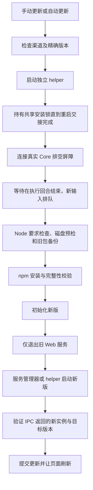

# Web 服务更新与一次性恢复

本说明只覆盖服务端 npm / Web 更新。Android、iOS、macOS 安装包有各自的更新协议。

针对安装锁、更新中断与完成状态的后续重构，见 [事务式更新与自动回滚设计提案](web-update-transaction-design.md)。该提案尚未实现；不要把设计保证当作当前更新器已有能力。

## 渠道和版本顺序

“Beta 通道”是用户的持续订阅；“自动更新 Web 服务”是独立的安装开关。

| 订阅 | 查询候选 | 选择规则 |
| --- | --- | --- |
| 正式 | npm `latest` | 只接受纯 `X.Y.Z` 正式版本 |
| Beta | npm `latest` 与 `beta` | 选择较新的有效版本；同号正式版高于 beta |

例如 `4.91.0-beta.10` 会收到 `4.91.0`；随后发布 `4.91.1-beta.11` 时继续收到它。
安装正式版不会关闭 Beta 订阅。`4.91.1-beta.11` 不会被 `4.91.0` 自动替换。
本地 `X.Y.Z-debug.*` 代表该正式 tag 之后的源码，因此也不会自动“升级”到同号正式版。
用户主动点击“更新或重新安装”允许重新安装或返回所选渠道的较旧版本。

检查结果保留实际候选的 `distTag`、精确 `installSpec` 以及持续订阅 `channel`。
安装始终使用查到的精确版本，避免检查与安装之间 dist-tag 移动。

## 执行过程



手动与自动更新共用同一 helper，不在运行中的自动更新里调用完整 `service:install`。
排空超时、状态未知和安装失败均不主动停止旧服务；失败释放排空屏障。
Render 与 terminald 不随 Web 更新而重启。
旧包备份保留到新进程实际响应；初始化失败可恢复原安装。新版执行状态不能安全确认时，
不强杀它进行回滚，保留备份并提示恢复入口。回滚备份不立即删除，避免旧进程的迟到导入失效。
安装目录以运行中包的位置为准，不随登录 shell 的默认 npm prefix 改变。

helper 写入私有日志及状态文件，操作索引保存在配置目录，因此更新后的新服务也能继续报告原任务阶段。
管理员可通过 `/api/update-status` 查询阶段。
API 返回“已开始”表示异步任务启动，不表示安装成功。
页面不能因旧进程仍响应 `/api/config` 就认为更新完成；确认失败立即显示失败信息。
管理员更新端点仍拒绝无 admin scope 的 connected-app。
设置页和通知卡片都使用 HTTP 更新回执里的实例 ID 与版本，不依赖 WebSocket 通知到达。
HTTP 明确拒绝时不启动重启等待层；失败等待层明确显示“更新未完成”。

Web 更新使用运行服务的 Node，不能升级 Node 本身。安装前检查目标包的 Node 最低要求，
npm 安装同时启用 `--engine-strict`，不把不兼容的新包留给旧 Node 重启。

### Node 支持范围

运行最低版本为 **22.19.0**，来自固定 Pi SDK 依赖的最低要求；内置 SQLite 与免 flag TypeScript
执行也已覆盖此下限。支持 22.19+、24.x、26.x；推荐使用仍受 Node 官方维护的偶数 LTS 分支，
不承诺支持已 EOL 的奇数分支。Node 20 没有本项目必需的 `node:sqlite`，不能只改 engine 宣称兼容。
`.nvmrc` 继续固定 CI/发布/体积测量版本，不再强制用户升级到同一 patch。
安装与恢复先接受当前兼容 Node，再选择已有 runtime；目标包要求更高时才另行安装，不修改默认 alias。

依据：[Node 官方维护周期](https://github.com/nodejs/Release#release-schedule)、
[SQLite 版本历史](https://nodejs.org/download/release/v22.19.0/docs/api/sqlite.html)。
同类工具也按最低能力而非开发机 patch 限制版本，例如 [Vite](https://vite.dev/guide/)；
Wand 的下限仍以自身依赖与实测为准，不能照抄其他项目。

## 旧版更新失败的恢复入口

旧更新器的代码不会因新包发布就自动改变。已被旧入口或 Node 要求卡住的用户，
需要在终端执行一次独立恢复入口；恢复后可继续使用 Web 更新。

```bash
bash <(curl -fLsS https://raw.githubusercontent.com/co0ontty/wand/master/install.sh)
```

入口先复用当前或已安装的兼容 Node，不改默认 nvm alias、也不移除旧运行时；
必要时通过用户已经配置的 nvm 安装目标 Node。没有兼容 runtime/nvm 时仍给出明确安装提示，旧服务不动。
脚本不能通过 Web 自动获取新的系统权限。
Linux 托管 Web 更新依赖能够启动的独立 `systemd-run` 单元；不可用时明确拒绝更新，
不能把同一 cgroup 内会被服务停止一起回收的普通子进程当作可靠 helper。

既有安装进入 `scripts/recover-web-update.sh`：

1. 从显式配置路径或旧服务注册发现原配置，只读已有配置与 SQLite；旧数据库没有 app_config 表时仍保留 JSON 中的订阅。
   即使换 Node 后 npm root 变了，已有配置/数据库也归升级路径。选择有效的精确版本。
2. 在隔离的临时 prefix 下载完整运行时。下载、engine 校验或 CLI 启动验证失败时，旧服务不动。
3. **先取得共享部署锁，再连接排空协议**。恢复入口与 Web 更新、`start.sh` 复用同一模块，
   校验父进程的路径/token/PID 回执后可继承锁，子进程不能释放父锁；普通竞争在排空之前拒绝。
   使用独立控制脚本连接真实服务。现代协议保持 Core 排空屏障；更旧协议经已验证的 IPC 身份和本机认证查询真实结构化执行/队列。
   接口未知、认证失败、会话状态不完整不当作空闲。旧协议没有 admission barrier，首次恢复等待期间请勿新增任务。
4. 安装锁覆盖排空、目标磁盘 staging、原子切换和健康验证，失败后只释放本次拥有的锁。
5. 原包与原 shim 保留在 npm scope 下 `.wand-recovery-backup-*`，包括以前安装失败的残缺包。
6. 包和数据库初始化不整体 sudo；系统服务注册单独提权。默认 npm 目录不可写时迁到用户的 `~/.wand/runtime/npm`，
   后续更新器识别自身 prefix，避免普通服务用户再次卡在 root-owned 安装上。持久 daemon 不做主动重启。
7. 新版必须在 IPC 报告实际 PID、版本和原配置；失败按安全状态恢复原包、shim 与注册文件，或保留备份明确报错。
   恢复代码不依赖旧目标 npm 包包含新 helper。单次安装原本未运行时不会凭死 pidfile 擅自启动。

“原生 Core 回合已全部完成”只表示排空检查通过，不代表安装成功。锁冲突现在报告锁路径、PID
及存活/退出/未知事实，不再把这三种情况一概描述为另一个更新仍在运行。
异常退出的历史锁仍需核查：PID 已死不代表 npm 子进程已停，也不能保证中断的安装完整；
在写者与事务状态未确认前不会自动删锁。完整崩溃恢复仍属上述事务设计提案，尚未实现。

脚本不清空 `~/.wand`、数据库、配置、历史或用户的 `.wand-*` 备份，也不做宽泛 `pkill`。
如果同时存在 system/user 两份服务，会在修改安装前拒绝，须先明确要保留哪份。
未知状态不能视为空闲。`4.26.3` 等没有 Core 接口的服务可走上述旧协议恢复；不依据版本号猜测执行已经结束。
新版包附带离线恢复代码和控制模块，已拿到新版后可直接运行 `wand update:repair -c /path/to/config.json`，
无需再次从 GitHub 下载脚本（安装包获取仍使用 npm）。

可指定本次恢复目标，不改长期订阅：

```bash
WAND_UPDATE_CHANNEL=stable bash <(curl -fLsS https://raw.githubusercontent.com/co0ontty/wand/master/install.sh)
WAND_UPDATE_CHANNEL=beta bash <(curl -fLsS https://raw.githubusercontent.com/co0ontty/wand/master/install.sh)
WAND_CONFIG_PATH=/path/to/config.json bash <(curl -fLsS https://raw.githubusercontent.com/co0ontty/wand/master/install.sh)
```

恢复包来源仍是 npm 已发布候选。要把本说明的新 Web 更新行为交付给其他用户，
必须先发布包含修复的 npm 包，并让 master 的安装脚本及恢复脚本可下载。
本机源码修改或本地部署不代表其他用户已恢复。

## 已核实的故障时间与影响

| 断点 | 证据和时间 | 受影响条件 |
| --- | --- | --- |
| 旧服务入口拒绝 Web 更新 | 保留 Git 历史 `60c1f55`（2026-07-27）已有该预检；下载 npm `4.26.3` 的 `dist/update-helper.js` 也已确认。该包北京时间 2026-07-27 07:47:22 发布 | service 指向源码或包内 `dist/cli.js`，而非稳定全局 shim；不是最近新增的统一故障 |
| Node 要求提高 | Git `d53214a`（2026-10-08）提高基线；npm 正式版中最早的 `>=24.21.0` 为 `4.87.0`，北京时间 2026-10-09 10:42:59 发布 | 旧 Web 服务仍用较旧 Node；旧 npm 仅警告 engine 时可能装完后无法用旧 Node 初始化或重启 |
| Beta 漏接正式版 | 2026-10-10 的 Beta 渠道整理记录保留了“仅查 beta”的选择逻辑，`4.89.4` 于当日 14:05:05 发布 | 正式版比 beta tag 新，但 Beta 用户仍只看到旧 beta；正式/Beta 发布工作流各自更新不同 tag |
| 自动更新重注册风险 | 保留历史 `60c1f55` 的 server 已在自动更新成功后调用完整 `repairServiceUnitAfterUpdate`；macOS service 安装会 bootout/bootstrap 当前 Web | 可写 system/user service 的自动更新可能先重启服务，再到后面的 Core 排空逻辑 |
| 设置页/通知卡片漏接回执 | 本轮基线中设置页只显示返回消息，重启回调签名丢弃实例 ID/版本；通知卡片直接调用无目标的等待层 | WebSocket 通知漏接时可能只显示已开始，或旧服务仍在线即误报完成；本轮已统一回执驱动 |
| 磁盘不足 | 本机日志实际有可用 883/814 MiB、要求 1.42 GiB 的拒绝，当前版本为 `4.42.0-debug.*`，目标 `4.42.1` | 可用空间不足以保存旧包、新包和回滚余量；保护性拒绝应保留，需释放磁盘空间 |

日志中同时存在近期自动更新成功记录，不能把所有失败归为一个原因。
历史已做过 squash，最早保留提交/已发布包只证明问题在当时已经存在，不冒充更早的精确引入提交。
磁盘失败日志没有事件时间戳，不能仅由 debug 后缀推断发生日期。

回归入口：`tests/npm-update-utils.test.ts`、`tests/update-channel-transition.test.ts`、
`tests/update-helper.test.ts`、`tests/core-restart-guard.test.ts`、`tests/web-update-recovery.test.ts`、
`tests/update-deployment-lock.test.ts`、`tests/update-compatibility.test.ts`、`tests/update-node-bootstrap.test.ts`。
